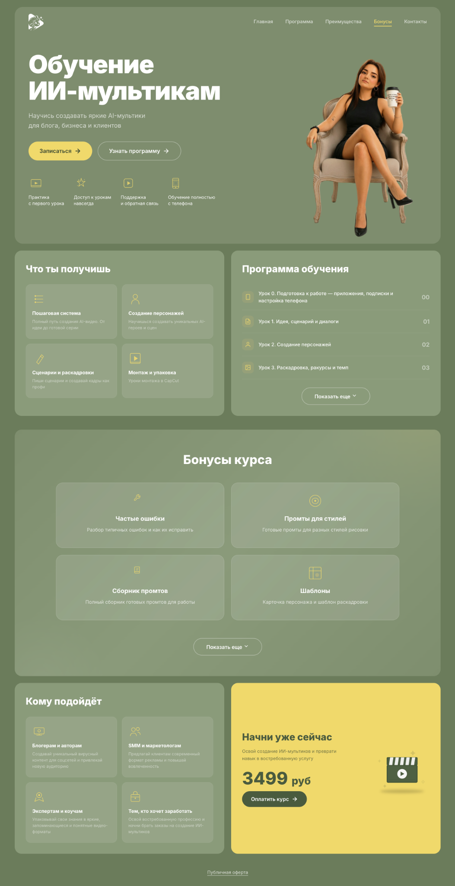

# Antonova AI — сайт курса и Telegram-бот

🌐 https://antonovaai.ru/
🤖 [@antonovaai_multiki_bot](https://t.me/antonovaai_multiki_bot)

## Состав проекта

- `index.html`, `css/`, `js/`, `img/` — статический лендинг, размещаемый через Netlify.
- `offer.html`, `privacy.html`, `payment-success.html` — юридические и информационные страницы.
- `docs/site-preview.png` — актуальный **пользовательский** скриншот сайта (цена 3 499 ₽).
- `telegram_bot/` — Telegram-бот с **Robokassa**, проверкой оплат и выдачей доступа.

## Цена и оплата

Обычная цена курса — **3 499 ₽** (с 1 ноября 2026 года).
Промокод `WOWNOW` даёт скидку 500 ₽ по правилам, установленным в базе данных.
Сайт только перенаправляет в Telegram: расчёт суммы и создание платёжной ссылки — на сервере бота.

**Проверенная боевая конфигурация запущена на Timeweb и не обновляется автоматически при GitHub push.**
`telegram_bot/.env` с рабочими секретами хранится только на сервере; для локального конфигурирования смотрите `.env.example`.

## Синхронизация исходников

Если в репозитории нужен код, **в точности соответствующий запущенному на Timeweb**, используйте приложенный сценарий
`tools/publish_from_timeweb.sh` (также отдельно в архиве): он получает только `.py` + `requirements.txt` из рабочей директории, заменяет устаревшего бота в чистом клоне
GitHub, подставляет **оригинальный присланный скриншот**, выполняет статические проверки и делает один commit + push.

Не копируйте `.env`, `education.db`, платёжные пароли, архивы или логи на GitHub.
Не запускайте второго polling-бота с тем же Telegram-токеном.

## Развёртывание

Сайт публикуется Netlify из GitHub `main`. Бот исполняется отдельно на Timeweb как
`antonova-robokassa.service`, callback HTTPS на `https://pay.antonovaai.ru`.
Для смены исполняемого кода на Timeweb требуется отдельное контролируемое развёртывание;
**GitHub push не меняет работающий сервер автоматически**.

## Тестирование

Сначала статическая проверка файлов, затем тесты Python в отдельном окружении и на отдельной тестовой базе.
Не выполняйте тесты с боевыми паролями и настоящей базой заказов.
